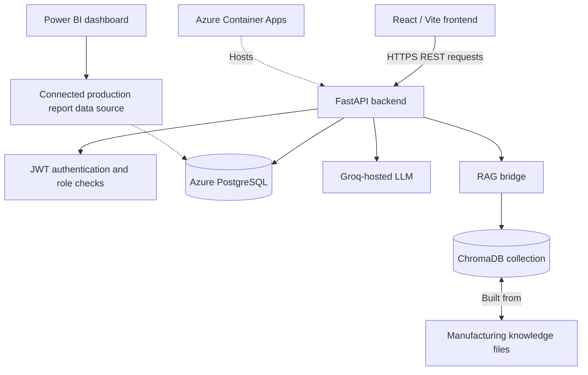

# AI Production Issue Management System

**Industrial AI · Root Cause Analysis · RAG · Cloud Deployment · Production Analytics**

A full-stack prototype for documenting manufacturing issues, generating AI-assisted assessments, and exploring production performance. The system combines a React interface, a FastAPI backend, PostgreSQL, retrieval-augmented generation (RAG), and an Azure-hosted deployment. A connected Power BI report provides a separate analytics layer.

> **Project status:** Version 3 — active development. Demonstration data is synthetic. AI outputs are decision-support suggestions, not validated engineering or safety instructions.

## Project at a glance

| Area | Implementation |
| --- | --- |
| User interface | React 19, Vite |
| Backend | Python, FastAPI, REST endpoints |
| Database | PostgreSQL via Psycopg; Azure Database for PostgreSQL Flexible Server |
| Authentication | Password hashing, JWT, operator/engineer roles |
| AI analysis | Groq API, `openai/gpt-oss-20b` |
| Retrieval | ChromaDB, curated manufacturing knowledge documents |
| Cloud | Azure Container Apps, Azure Storage Account, Log Analytics workspace |
| Analytics | Microsoft Power BI, connected to a project data source |
| Packaging | Dockerfile for the Python API |

## Why this project?

Manufacturing teams need a consistent way to capture equipment and process issues, review possible causes, prioritize incidents, and understand recurring production losses. This project explores a workflow that connects issue reporting with AI-supported analysis and business intelligence, with a focus on process improvement and engineering visibility.

## Main capabilities

- **Structured issue reporting:** Capture problem type, description, downtime, temperature, pressure, cycle time, and operator comments.
- **AI-assisted assessment:** Generate a proposed category, severity, possible cause, recommended action, and confidence value.
- **Knowledge-grounded analysis:** Retrieve relevant context from a local ChromaDB collection built from severity, cause, and recommended-action reference documents. The API invokes the RAG bridge during analysis and handles retrieval errors separately.
- **User authentication:** Sign in with stored password hashes and receive a JWT access token.
- **Role-based workflows:** Engineer-protected report listing, report details, and status updates (`OPEN`, `UNDER_REVIEW`, `RESOLVED`).
- **Cloud-backed storage:** Persist reports in PostgreSQL, with a deployed API component in Azure Container Apps.
- **Power BI reporting:** Explore production issue counts, severity distribution, downtime, resolution rate, status, and AI assessment fields.

## Architecture



*Architecture is a conceptual overview. The Power BI connection is established, but its exact connector/query path should be documented from the `.pbix` configuration. ChromaDB initialization and persistence in the cloud environment should be verified independently.*

## AI and RAG workflow

1. An operator submits a production issue with process parameters and a description.
2. FastAPI prepares a text context and calls the RAG bridge to retrieve reference information.
3. The AI analysis module calls the Groq API for a structured assessment.
4. The backend stores the report and generated analysis in PostgreSQL.
5. Authorized engineers can review reports and update their status.
6. Power BI presents aggregate production and AI-analysis metrics.

The current analysis code includes an injection-molding-oriented evaluation rubric and example process windows. These values are part of the prototype and **must not be treated as universal production limits**.

## Azure deployment

The Azure environment shown for this project includes:

- **Azure Container App:** `ai-production-api` — deployed backend service.
- **Azure Database for PostgreSQL Flexible Server:** `ai-production-db-amin` — cloud database resource.
- **Azure Storage Account:** `aiproductionuiamin` — storage resource associated with the project.
- **Container Apps Environment**, **Log Analytics workspace**, and **Resource Group** for the deployment environment.

The frontend code points to an Azure-hosted API, and the API CORS configuration includes an Azure static-website origin. The deployment screenshots establish the resources; they do not by themselves prove availability, uptime, or end-to-end production readiness.

## Power BI analytics

A connected Power BI Desktop report currently includes:

**Production Overview** — cards and visuals for total reports, average/total downtime, resolution rate, high-severity issues, severity distribution, issue status, and report trends.

**AI Insights** — a report-level table containing report ID, problem type, AI severity, AI confidence, and status.

**AI Model & Architecture** — **planned / in progress**. This page will explain the application architecture, technology stack, and AI/RAG workflow; it is not yet presented as complete.

The screenshots shared during development show a sample dataset of **17 reports**, **298 total downtime**, **11.76% resolution rate**, and **6 high-severity reports**. These are illustrative dashboard values, not measured industrial performance claims; the downtime unit is not established from the screenshot.

## API endpoints

| Method | Endpoint | Purpose | Access |
| --- | --- | --- | --- |
| `GET` | `/` | API home response | Public |
| `POST` | `/auth/login` | Authenticate and issue JWT | Public |
| `POST` | `/analyze` | Analyze and store a production report | No auth dependency in current code |
| `GET` | `/reports` | List reports | Engineer JWT |
| `GET` | `/reports/{report_id}` | Retrieve one report | Engineer JWT |
| `PATCH` | `/reports/{report_id}/status` | Update report status | Engineer JWT |

**Security note:** The current `/analyze` endpoint does not enforce a JWT dependency at the API layer. This is a known hardening task before any production-facing release.

## Run locally

**Prerequisites:** Python, Node.js/npm, a reachable PostgreSQL database with the expected schema and user records, and a Groq API key. Check package compatibility with your installed Python/Node versions.

1. Clone the repository and create a Python virtual environment:

   ```bash
   git clone https://github.com/amin-ghasemi-de/AI-Production-Issue-System.git
   cd AI-Production-Issue-System
   python -m venv .venv
   # Windows PowerShell:
   .venv\Scripts\Activate.ps1
   pip install -r requirements.txt
   ```

2. Create a local `.env` file (do not commit it):

   ```dotenv
   GROQ_API_KEY=your_groq_api_key
   JWT_SECRET_KEY=replace_with_a_long_random_secret
   DB_HOST=your_postgresql_host
   DB_PORT=5432
   DB_NAME=your_database_name
   DB_USER=your_database_user
   DB_PASSWORD=your_database_password
   ```

3. Set up the PostgreSQL schema and user accounts appropriate for your environment. The repository includes `create_tables.py`, but initialization and user provisioning must be checked against your target database before running them.

4. Build the local vector collection:

   ```bash
   python rag/build_vector_db.py
   ```

5. Start the API:

   ```bash
   uvicorn api:app --reload
   ```

   API documentation: `http://127.0.0.1:8000/docs`.

6. In another terminal, start the React frontend:

   ```bash
   cd frontend
   npm ci
   npm run dev
   ```

   **Important:** The current React source contains hard-coded Azure API URLs. For a fully local frontend/backend workflow, replace these with a configurable API base URL before running the UI locally.

## Repository layout

```text
AI-Production-Issue-System/
├── api.py                 # FastAPI routes and database operations
├── auth.py                # JWT and password utilities
├── ai_analyzer.py         # LLM-based production issue analysis
├── rag_bridge.py          # Integration with RAG
├── rag/                   # Retrieval and vector DB scripts
├── knowledge/             # Reference text documents
├── frontend/              # React / Vite application
├── evaluate_llm.py        # Evaluation utilities
├── evaluation_dataset.json
├── Dockerfile             # Backend container definition
└── requirements.txt
```

## Security, scope and limitations

- Secrets are read from environment variables; `.env` is excluded from Git tracking in the supplied project snapshot.
- Role checks are implemented for engineer report-review routes; the analysis route needs additional authorization review.
- RAG's local vector collection is excluded from version control and must be built or provisioned in each environment.
- The Dockerfile packages the backend, not the complete multi-service deployment.
- Cloud service health, automated tests, monitoring behavior, and production readiness have **not** been independently verified in this README.
- The evaluation dataset and reports are for demonstration and experimentation.

## Roadmap

- [ ] Complete the **AI Model & Architecture** page in Power BI.
- [ ] Document the exact Power BI data connector and refresh strategy.
- [ ] Move frontend API URLs into environment-based configuration.
- [ ] Review authorization for all write endpoints and tighten input validation.
- [ ] Verify vector-store provisioning and persistence in Azure.
- [ ] Add automated tests, CI checks, and a repeatable deployment guide.
- [ ] Add sanitized screenshots of the application and Power BI report.

## Project evolution

- **Version 1:** Initial Python-based production issue reporting prototype.
- **Version 2:** Expanded reporting, analytics, and local AI experimentation.
- **Version 3:** React/FastAPI architecture, JWT-based engineer workflows, PostgreSQL, Groq-assisted analysis, RAG, Azure deployment, and connected Power BI reporting.

---

**Portfolio project:** AI-assisted manufacturing issue management and process-improvement analytics. Developed using synthetic demonstration data.
